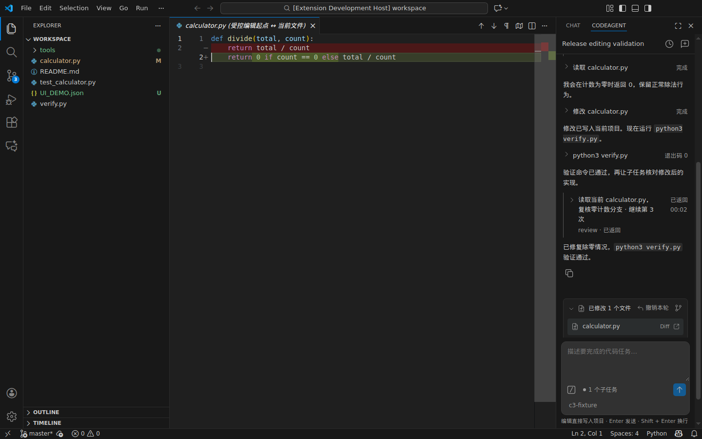

# CodeAgent

**在 VS Code 中把代码任务交给 Agent，查看执行过程，审查和撤销项目修改。**

CodeAgent 是面向 Linux／WSL2 的本地 Coding Agent。模型通过工具调查代码、修改文件和运行测试，Runtime 负责上下文、权限、操作记录与中断恢复。你可以围绕同一个项目持续追问，在编辑器中查看每一步反馈，并随时停止执行。

[安装与使用](docs/INSTALLATION.md) · [架构与设计](docs/ARCHITECTURE.md) · [测评报告](docs/HAL50_EVALUATION.md) · [版本与下载](https://github.com/YeYan0829/codingAgent/releases)

<p align="center">
  <a href="docs/assets/ui-v06-release/native-diff.png"></a>
</p>

## 从一个目标推进到可检查的修改

打开项目，在 CodeAgent 侧栏描述目标，例如“修复零数量时报错的问题，补充回归测试并运行验证”。Agent 先查找调用方和相关测试，再修改实现、执行命令，并根据反馈继续工作。工具、命令与可选子任务按顺序展示，最后的答复解释修改及验证结果。

修改直接写入当前项目，与已有 staged、unstaged 和 untracked 文件共存。点击修改文件可打开 VS Code 原生 Diff；“撤销本轮”恢复最近一轮受控文件编辑。撤销前会检查全部涉及文件，遇到外部改动保留现场。命令产生的其他副作用由实际权限和执行环境管理。

需要网络或项目外写入时，界面显示具体权限请求。Stop 取消在途模型、子任务和命令，等待资源回收后回到可操作状态。历史记录保留对话、工具结果和修改来源，便于继续任务或检查异常。

## 让多轮编码建立在可靠的执行基础上

**一套循环连接调查、修改和验证。** 主 Agent 与专项子角色共用 AgentLoop、请求记录和上下文机制。默认单 Agent；需要分工时，可同步委派代码调查、测试命令或局部实现，再沿同一子历史续问。权限由角色、父工具集和父策略共同确定。

**工作记忆与原始来源各有位置。** 近期完整工具交换保留在上下文中，较早历史通过滚动摘要压缩；已采集的工具输出和命令日志持久保存，可按来源分页回读。模型收到当前用户要求、执行环境和自己的历史，据此继续操作。

**严格检查落实到真实操作。** 工具输入由同一类型定义生成 schema 并执行校验；编辑检查目标内容与文件冲突，命令经过 ToolRegistry、Policy、Approval 和 Bubblewrap。沙箱不可用时拒绝命令。恢复时复用已保存结果，对结果未知的模型请求和写操作保留现场，避免重复执行。

这些设计的调用链、源码入口及对应回归见[架构与设计](docs/ARCHITECTURE.md)。

## 真实仓库任务中的表现

在固定 HAL SWE-bench Verified Mini 50 题上，CodeAgent v0.6.0 配合 GLM-5.3／high、单 Agent 完成 **40/50（80%）**，模型费用已知估价约 **150.85 元**。历史 v0.5.0 为 **35/50（70%）**，约 **150.04 元**；原先通过的 35 题在新版全部通过。

测评覆盖 Django、SymPy、scikit-learn 等 11 个仓库。代表案例包括沿 Django 表单构造与保存链定位状态问题、复用 scikit-learn 已有交叉验证抽象，以及撤回修复验证新增测试确实能检出旧错误。未通过任务则揭示了修复层次、行为边界和长任务验证安排中的具体问题。

两轮采用各自的网络、上下文及执行设置。[测评报告](docs/HAL50_EVALUATION.md)集中说明方法、版本差异、逐题案例和成本，并提供两版证据的检阅方式。

## 安装与开始

当前源码与本轮安装包版本为 **v0.6.0**，由 Python Runtime 和配套 VS Code 插件组成。支持 Python 3.11+、VS Code 1.106+；代码搜索使用 ripgrep，本地命令使用 Bubblewrap。

本地安装包位于 `dist/`，公开下载以 [Releases](https://github.com/YeYan0829/codingAgent/releases) 列出的版本为准。按[安装说明](docs/INSTALLATION.md)配置 Runtime 路径和模型。在已克隆的仓库根目录安装源码：

```bash
python3 -m venv .venv
.venv/bin/python -m pip install -e .
.venv/bin/codeagent ask . '读取 README 并概括项目' --provider fake
```

Fake provider 用于免费检查读取与连接。连接 GLM 或 DeepSeek 后即可处理真实任务；模型服务按供应商规则计费。普通本地任务使用 Bubblewrap，Docker 用于 SWE-bench 测评。

开发者从[源码阅读路线](docs/ARCHITECTURE.md#源码阅读路线)进入模块，按[开发测试与构建](docs/INSTALLATION.md#7-开发测试与构建)运行回归和生成安装包。用户可见的版本变化见 [CHANGELOG](CHANGELOG.md)。

## License

[MIT](LICENSE)。内置的上游工具与提示适配保留固定来源及许可证，见[来源与许可说明](codeagent/prompts/licenses/README.md)。
