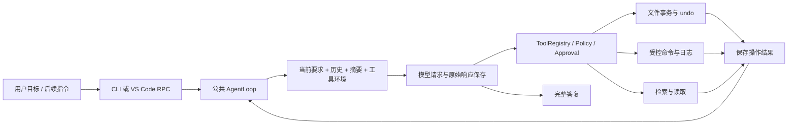

# 架构与设计：让一次代码任务持续推进

CodeAgent 将模型决策、可靠执行和产品交互分开组织：模型根据目标和反馈选择下一步，Runtime 维护真实操作与会话状态，VS Code 展示过程并接收用户干预。这一分工让调查、编辑、测试和追问发生在同一个当前项目中，同时为权限、冲突和故障恢复保留明确的处理位置。

## 从用户目标到执行反馈

CLI 与 VS Code RPC 使用相同的应用入口组装模型、工具、工作区和会话。`AgentRunner` 保存用户消息、取得会话执行权，随后由公共 `AgentLoop` 推进模型与工具交换。

每次工具结果进入下一轮请求，模型据此修正调查或方案。普通任务按反馈持续推进，请求次数、token 与费用随过程记录；模型容量、权限、单次命令 timeout 和用户 Stop 分别在对应边界处理。测评的整题时间、费用上限放在独立 benchmark 控制器中。

## 在当前项目中编辑，把恢复落实到文件事务

持续开发常从已有暂存、未暂存和未跟踪文件开始。v0.6.0 将当前项目作为共同工作对象：初始化无需 Git HEAD，编辑不创建候选 worktree，也不自动提交或重置用户 index。用户可以立即运行项目，并通过 Diff 检查变化。

常见修改使用 `edit_file`，按精确且唯一的原文定位；可选 hash 用于整文件版本检查。新建、删除、移动和多文件修改使用 `apply_workspace_edit`。操作先准备涉及文件的内容与备份，提交前再检查实际状态。中途失败恢复已经写入的内容；恢复无法确认时保留事务材料并限制后续写入。

事务在会话目录保存前后内容、文件权限与状态，成功后仍可跨进程撤销。Undo 先检查全部涉及路径，再整组恢复；文件被外部修改时拒绝覆盖。恢复范围对应受控文件编辑，命令的其他副作用继续由命令权限和进程生命周期管理。

这一设计把“怎样改文件”集中到 `AtomicEditService`，把 Diff 和确认框交给产品层。新执行后端可以复用事务计划、匹配与撤销规则，通过项目 I/O 适配访问自己的文件系统。对应验证覆盖脏工作区、跨文件失败、外部冲突和重启撤销，见[编辑回归](../tests/test_direct_edit_undo.py)与[事务回归](../tests/test_atomic_edit.py)。

## 用原始来源支撑长任务记忆

模型的工作上下文由当前用户要求、近期完整历史、较早历史摘要和执行环境组成。文件工具决定读取范围，命令工具提供输出预览与来源；原始已采集观察持久保存，模型通过 `read_observation` 分页回读。Context 层整理协议和历史，保留工具已经交付的正文。

历史较长时，Runtime 对完整旧前缀执行滚动语义摘要。当前用户要求继续以原文提供，近期工具调用与结果按完整交换保留。摘要返回后以实际文本重新装配输入；空摘要、截断和失败结果保留旧历史。容量计算与最终发送共用同一入口，避免不同阶段对可用窗口作出不同判断。

压缩后的结论带有来源，模型仍可重新读取原始观察。子角色使用自己的历史和来源权限，主子共用相同装配与摘要实现。重新打开会话时使用项目当前文件，旧观察提供工作背景，需要当前状态时再读文件。

可用输入按 `context_limit - max_output_tokens - TOKEN_COUNT_MARGIN` 计算，消息与工具 schema 共用 `estimate_request_tokens` 估算。历史达到事件阈值时提前尝试摘要，超出输入容量时再选择放得下的完整旧前缀。摘要必须保留来源，实际返回内容重新进入容量检查。[观察保留](../tests/test_observation_retention.py)和[语义压缩回归](../tests/test_semantic_condensation.py)检查来源回读、坏摘要和跨进程恢复。

## 从工具定义到真实资源权限

工具输入使用 Pydantic 类型生成模型 schema，handler 校验相同类型；路径存在、原文唯一匹配等条件由实际操作服务检查。工具能力区分读取、项目写入、命令执行和会话控制，角色权限由 ToolRegistry 与 Policy 共同落实。

命令执行依次检查参数、资源许可和运行环境。Bubblewrap 默认将宿主只读挂载，项目与私有运行目录按需可写，Git 与 Runtime 元数据受保护；网络和额外宿主写入通过 Approval。仓库禁止路径在文件工具、Git 和命令挂载中共同生效。无法建立沙箱时返回拒绝结果。

每条命令启动 fresh shell，`cd` 与进程内环境修改仅影响当次调用。本地 `/tmp` 每次重新创建，HOME 与项目文件可持久保留。命令退出、timeout 与 Stop 都处理进程后代；已采集 stdout／stderr 保留来源，读取日志不会重新执行命令。`purpose=validation` 启用 Bash pipefail；测试结论还需结合输出摘要与实际覆盖判断。

仓库禁止路径由文件工具、Git 查询和命令挂载共同落实，普通资源批准不能解禁。已有凭据目录、会话目录和系统 socket 按实现遮罩。访问范围变化后新建会话，避免沿用含旧范围观察的上下文。允许读取的源码与输出可以进入模型请求及本地会话，API Key 由插件 SecretStorage 或 CLI 环境变量提供。

工具接口的类型、描述、Provider schema、合法输入及错误反馈一同维护；权限分类按实际副作用确定。文件读取返回实际行／字节范围，检索说明匹配模式、过滤与分页；命令返回真实退出状态和持久来源。真实 Bubblewrap 集成在隔离临时仓库检查只读挂载、网络、持久文件和取消回收，核心回归见[工具合同](../tests/test_live_tool_contracts.py)与[命令沙箱](../tests/test_command_sandbox_service.py)。

## 让专项分工复用同一执行核心

同步 `task` 接受目标与角色，`resume` 续接同一个子历史。code-explorer 负责只读调查，bash-runner 使用受控命令，general-purpose 可以受控编辑和运行命令。三类角色复用主方的 AgentLoop、上下文、请求记录及操作服务；工具权限取角色、父 Registry 和父 Policy 的交集。

主方等待子终态与资源回收后继续，多个工具顺序执行。主子共享当前项目，子历史独立，角色不能递归委派。这样既能在同一任务中形成局部调查和实现分工，也让取消、来源回读和文件恢复沿用公共机制。

角色与协议参考固定版本 OpenHands 的 TaskAction 和提示，编辑提示适配 Aider；固定来源、接口映射与许可证保存在[随附来源与许可说明](../codeagent/prompts/licenses/README.md)。角色输入及权限见[角色定义](../codeagent/orchestration/profiles.py)，生命周期与结果回传见[子任务实现](../codeagent/orchestration/agents.py)。历史后台事件继续由兼容层读取，普通模型使用同步入口。

## 保存操作身份，使中断后能够准确接续

SessionStore 以追加事件记录用户消息、请求意图、原始响应、工具意图与结果。每次实际操作使用稳定身份，响应先保存再执行后续工具。读取与追加使用跨进程文件锁，保证读方等待完整 JSONL 记录。

恢复按已发生的事实处理：已有响应和工具结果直接复用；已派发但结果未知的模型请求保留 UNKNOWN，未知写操作进入现场检查。会话 lease 与执行世代阻止两个执行者同时接管以及旧 worker 的晚到写入。Stop、RPC 断开和宿主退出共用取消回收路径。

请求账本分别保存主方、子方和摘要的用量及价格快照。确认未派发的请求记录为 `not_dispatched`，派发后无可靠响应继续保留未知状态；费用汇总保留全部已知小计。对应回归包括[请求派发](../tests/test_request_dispatch_accounting.py)、[并发日志读取](../tests/test_session_event_concurrency.py)和[产品执行](../tests/test_product_execution.py)。

## 将执行核心接入编辑器和测评环境

VS Code 通过本地 JSON-RPC 调用产品应用服务。产品层将事件与文件事务投影为会话、工具过程、子任务、权限卡片和修改文件；VS Code 宿主提供 SecretStorage、原生 Diff 和确认框。插件刷新读取真实执行状态，运行中的新输入保存为草稿。请求分派见[RPC入口](../codeagent/product/rpc.py)，会话状态与修改读取见[产品服务](../codeagent/product/service.py)，协议回归见[RPC测试](../tests/test_product_rpc.py)。

SWE-bench 后端则将一题的全部项目工具接入同一个官方镜像容器 `/testbed`。文件读取、搜索、Git、编辑与命令访问同一份源码，题内 HOME、临时文件和依赖跨命令保留，shell 状态每次重建。公共工具定义、Policy、编辑事务和来源记录继续复用，结束后导出补丁并回收容器，由独立 grader 验收。

测评可选择断网或 filtered 出站代理。项目容器保持无直连网络，代理按规则提供 HTTP(S) 并保存独立审计；最终50题的设置、访问记录及评分兼容处理集中见[测评报告](HAL50_EVALUATION.md)。

## 源码阅读路线

建议先沿一次请求读通，再进入关注的操作服务：

| 阅读目标 | 入口 | 继续阅读 |
| --- | --- | --- |
| 启动会话和一轮任务 | [应用装配](../codeagent/application/session_runtime.py) | [Runner](../codeagent/runtime/runner.py) → [公共循环](../codeagent/orchestration/loop.py) |
| 模型协议与实际请求 | [模型类型](../codeagent/model_gateway/base.py) | [公共客户端](../codeagent/model_gateway/openai_client.py)、[请求执行器](../codeagent/runtime/request_executor.py) |
| 历史、容量与摘要 | [ContextManager](../codeagent/context/builder.py) | [历史投影](../codeagent/context/projector.py)、[摘要执行](../codeagent/runtime/context_preparation.py) |
| 工具与文件操作 | [输入类型](../codeagent/tools/inputs.py) | [Registry](../codeagent/tools/registry.py)、[编辑事务](../codeagent/runtime/atomic_edit.py) |
| 命令与权限 | [命令服务](../codeagent/runtime/command_service.py) | [Policy](../codeagent/runtime/policy.py)、[Bubblewrap](../codeagent/runtime/bubblewrap.py) |
| 子任务 | [角色定义](../codeagent/orchestration/profiles.py) | [子会话](../codeagent/orchestration/agents.py)、[私有上下文](../codeagent/orchestration/context.py) |
| 会话与产品 | [SessionStore](../codeagent/session/store.py) | [产品服务](../codeagent/product/service.py)、[RPC](../codeagent/product/rpc.py)、[插件](../vscode-extension/extension.js) |
| 评测适配 | [Harness](../codeagent/benchmark/swebench_harness.py) | [容器工作区](../codeagent/benchmark/swebench_container.py)、[网络代理](../codeagent/benchmark/swebench_network.py) |

`tests/` 按这些机制保留针对性回归；[开发测试与构建](INSTALLATION.md#7-开发测试与构建)提供免费验证和打包入口。完整 HAL50 结果在[测评报告](HAL50_EVALUATION.md)中沿真实任务展开。
