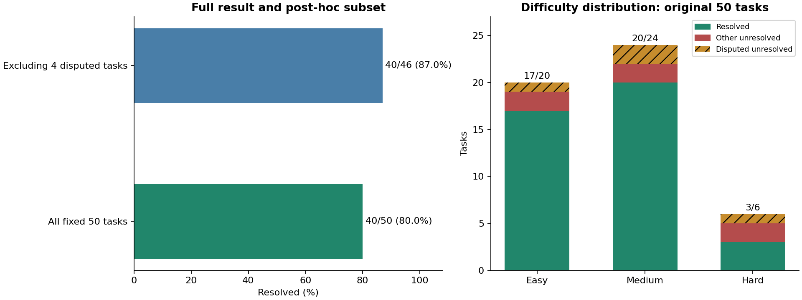
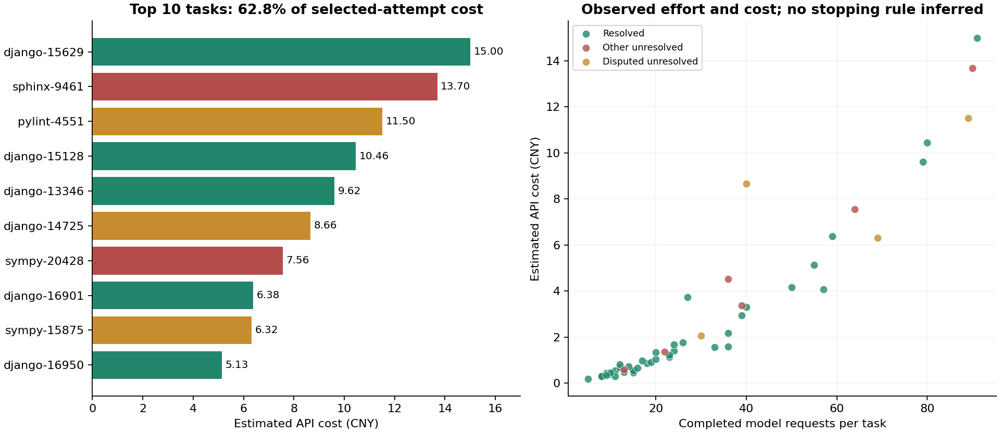

# CodeAgent Runtime：HAL SWE-bench Verified Mini 50题测评报告

CodeAgent Runtime面向真实仓库中的持续开发任务，为模型提供代码检索、受控编辑、命令执行和结果回读能力。本次使用v0.6.0搭配GLM-5.3，在HAL固定50题上完成最终版本测评：**完整成绩40/50，解决率80.00%；剔除逐题复核的4项题面争议后，成绩40/46，解决率86.96%。模型费用按请求账本估算约150.85元。**

本轮也是一次面向持续开发场景的版本验收。相比取得35/50的v0.5.0，新版将隔离候选交付调整为当前项目中的直接编辑与持久undo，将任务推进、工具执行和实验控制分开维护，并让项目工具共享一致的执行环境。本文先说明这些设计取舍及其效果，再结合实际轨迹分析Agent完成任务的过程、主要错误模式和成本结构。

## 1. 为什么选择HAL SWE benchmark

SWE-bench取材于真实开源仓库的GitHub issue。Agent获得问题描述和指定历史版本的代码，需要自行检索仓库、理解调用关系、修改实现，并提交可运行的补丁。这种任务把代码理解、工具使用和测试验证放在同一条工作链上，适合检验Code Agent能否在已有工程中持续推进任务。[SWE-bench论文](https://arxiv.org/abs/2310.06770)介绍了任务构造与评测方式。

SWE-bench Verified包含经过人工质量筛选的500道任务；HAL的Verified Mini进一步选取固定50题，便于以较低成本完成整轮测评。本轮沿用HAL提交`7b231a952828022a43977f21acfd452adda5088c`中的[固定题单](https://github.com/princeton-pli/hal-harness/blob/7b231a952828022a43977f21acfd452adda5088c/agent_eval_harness/benchmarks/swebench_verified_mini_task_ids.txt)，覆盖Django、SymPy、scikit-learn、Matplotlib、Sphinx等11个仓库。Verified的筛选过程见[数据集介绍](https://openai.com/index/introducing-swe-bench-verified/)。

每题按完整任务计1分：独立评分容器应用候选补丁和官方测试，检查目标缺陷对应的`FAIL_TO_PASS`测试，以及已有行为对应的`PASS_TO_PASS`回归测试，两组均满足才计为通过。Agent在解题阶段根据题面、仓库和自己的执行反馈工作，最终由独立测试验收。[官方评分文档](https://www.swebench.com/SWE-bench/guides/evaluation/)说明了容器化评分流程。

## 2. 测评如何运行

### 2.1 从仓库任务到独立验收

本轮使用冻结的Runtime源码、提示和模型配置，串行完成50题。该题集在项目开发阶段已有运行历史，本轮用于最终版本回归。每题从目标仓库的指定版本启动，在Docker容器的`/testbed`中执行检索、编辑和测试，结束后提取补丁，交给独立评分容器验收。

执行循环由普通Runtime承担：模型提出工具调用，ToolRegistry、Policy和Approval处理执行权限，工具返回文件内容、编辑结果或命令输出，模型据此决定下一步。受控编辑检查匹配内容和文件状态；命令输出持久保存，支持继续回读。这样，定位、修改和验证可以在同一个任务中连续进行，失败反馈也能进入下一轮决策。[SWE-agent研究](https://arxiv.org/abs/2405.15793)同样将仓库导航、文件编辑和程序执行接口视为Agent完成软件工程任务的重要组成。

| 项目 | 本轮设置 |
| --- | --- |
| Runtime | v0.6.0，冻结快照`762c0a545dab3e0ac7123e8ed8c0c9e24511d4db` |
| 任务与评分来源 | 固定HAL50；任务仓库提交`3d07b464…`，评分仓库提交`334882dd…`；逐题绑定镜像digest与源码身份 |
| 模型 | GLM-5.3，thinking开启，reasoning effort=`high`，temperature=`1.0` |
| 上下文与输出 | 上下文装配容量1,000,000 token；单次最大输出65,536 token；非流式请求 |
| 编排 | 单Agent，工具顺序执行，使用任务进度工具 |
| 工具 | 文件检索与读取、受控编辑、Diff、命令执行、持久输出回读 |
| 每题实验限额 | 解题阶段3,600秒、模型费用估价20元；派发下一请求前预留最坏费用 |
| 批次与重试 | 串行，SDK retry=0；服务故障或实验限额触发后暂停批次，人工续派 |
| 独立评分 | 单worker，测试timeout 1,800秒，评分调用timeout 2,100秒 |

题目按人工难度标签分组，依次执行20题Easy、24题Medium、6题Hard，组内保持HAL原顺序。标签依据熟悉代码库的工程师预计修复耗时划分，定义见[Verified标注指南](https://cdn.openai.com/introducing-swe-bench-verified/swe-b-annotation-instructions.pdf)。

### 2.2 联网、兼容与批次衔接

生成容器通过filtered代理联网：开放普通依赖下载和服务访问，屏蔽GitHub、API、raw、补丁及已知镜像入口；提示同时要求通过本地代码解决问题，禁止查找上游解法或下载目标项目新版源码参考修法。50题代理记录中，47题无出站访问，其余3题共28次访问，目的主机为`httpbin.org`、`pypi.org`和`files.pythonhosted.org`。其中Requests任务使用httpbin验证认证行为，Sphinx任务则通过本地构造复现题面中的外部示例。

前两题完成连通性检查后，核对运行配置并纳入最终结果，其余题目接续执行。Django-14725因HTTP500进行了一次基础设施重试；完整费用统计包含原尝试与重试。环境适配还处理了旧版Requests的代理/TLS兼容，以及Astropy评分脚本对测试文件重命名的恢复问题。Astropy保留原模型补丁，修正评分恢复后通过目标测试和339项登记回归，计入最终成绩。

## 3. 整体结果：40题完成独立验收

| 统计范围 | 通过分数 | 解决率 |
| --- | ---: | ---: |
| 固定完整50题 | **40/50** | **80.00%** |
| 剔除4项题面争议后 | **40/46** | **86.96%** |

四项争议为SymPy-15875、SymPy-17318、Django-14725和Pylint-4551，均涉及题面与隐藏验收之间的约定差异，逐题分析见第7节。

| 难度 | 完整题集 | 剔除争议题后 |
| --- | ---: | ---: |
| Easy | 17/20，85.00% | 17/19，89.47% |
| Medium | 20/24，83.33% | 20/22，90.91% |
| Hard | 3/6，50.00% | 3/5，60.00% |

Easy和Medium任务的通过率分别为85.00%和83.33%，Hard降至50.00%。仓库层面，Django通过20/22题，SymPy通过9/13题；其余未通过任务分布在Matplotlib、scikit-learn、Sphinx和Pylint。

| 仓库 | 通过/总数 | 未通过任务 |
| --- | ---: | --- |
| Django | 20/22 | 14725、14011 |
| SymPy | 9/13 | 18763、15875、17318、20428 |
| scikit-learn | 3/4 | 25747 |
| Sphinx | 2/3 | 9461 |
| Matplotlib | 1/2 | 23476 |
| Pylint | 0/1 | 4551 |
| Astropy、Requests、Flask、Xarray、Pytest | 各1/1 | — |

这些成绩对应一组持续执行的工程过程：50题选定尝试完成1,581次模型请求、1,700次工具调用，其中724次为命令执行。49题形成非空补丁，43题修改了至少两个文件；32题新增67个测试函数，7题同时修改文档。

## 4. 版本迭代：围绕持续开发重新划分Runtime职责

v0.5.0优先解决源仓库保护和修改交付：Agent在独立worktree中工作，Runtime维护候选代码、基线、验证版本与Accept/Discard状态。随着任务扩展到已有修改的项目、多轮调试和专项委派，工作区版本、测试资格与执行控制之间的关联逐渐增加。v0.6.0据此调整设计，把当前项目作为共同工作对象，将安全与恢复落实到文件事务、资源权限和实际操作状态。

两轮均使用固定HAL50和GLM-5.3/high，分别保留各版本的实际配置。整体结果如下：

| 版本结果 | v0.5.0 | v0.6.0 |
| --- | ---: | ---: |
| 完整50题通过数 | 35/50，70.00% | 40/50，80.00% |
| 模型费用估价 | 150.04元 | 150.85元 |
| 每道通过任务的摊销费用 | 4.29元 | 3.77元 |

两轮均保存实际生效配置，主要差异如下。这组结果描述整个版本的迭代，后文的固定输入重放用于解释具体接口效果。

| 条件 | v0.5.0 | v0.6.0 |
| --- | --- | --- |
| 生成端网络 | 断网 | filtered受控联网，访问记录另存 |
| 上下文装配容量 | 128,000 token | 1,000,000 token |
| 单次输出上限 | 8,192 token | 65,536 token |
| 单题执行限制 | 最多72个主ModelStep | 3,600秒、20元估价，派发前预留 |
| 项目环境 | 宿主候选目录与单命令容器 | 单题原生容器，文件和临时环境连续 |

旧版通过的35题在本轮全部通过，新增通过Astropy-7336、Django-13346、13809、15629、16950。两轮支出均约150元，整体解决率提高10个百分点，按通过题数计算的摊销费用下降约12%。下面分别说明工作方式、模块边界和工具交互发生了怎样的变化。

### 4.1 从隔离候选交付到当前项目中的受控修改

旧方案将源目录与Agent修改隔离，交付边界明确，适合从干净Git状态开始处理一份候选补丁。持续开发则经常从已有staged、unstaged和untracked文件开始，用户希望继续当前修改、立即运行项目，并随时检查或撤销Agent的操作。

新版直接编辑当前项目，保持用户的HEAD和index状态；修改审查围绕当前Diff进行，受控编辑保存文件前后内容与事务状态，重新打开同一会话后仍可undo。撤销前检查涉及文件，遇到外部修改冲突时保留现场。恢复粒度落到实际受控文件；命令的其他副作用由权限隔离、超时和进程回收管理。

这一选择把Runtime维护的状态从整份候选代码的交付生命周期，收束为每次操作的权限、冲突与恢复。用户可以在原有开发状态上连续工作，编辑服务负责局部事务，产品层负责展示Diff和撤销入口，命令服务负责真实执行与输出。[工作区与恢复设计](ARCHITECTURE.md)给出了对应边界。

### 4.2 将任务推进、可靠执行和实验控制分开维护

旧Runner同时处理执行切片、整轮步骤预算、候选状态与验证记录。新版本将普通推进过程组织为共享AgentLoop：装配上下文、请求模型、执行工具、保存反馈，再进入下一轮。主方和子角色共用这一循环，以及请求计量、上下文装配和摘要机制；角色差异集中在提示、私有历史与工具权限。

安全与恢复由公共执行层承担：每次模型请求和工具操作具有稳定身份，已经保存的结果可直接复用；结果未知的写操作进入恢复检查。实验的时间和费用限制放在benchmark控制器中，普通Runtime按模型反馈持续推进。验证命令的输出随轨迹保存，供模型继续调查和用户审查。

这样，新增专项子角色时可以复用已有请求、上下文和工具执行；调整测评限额时，修改集中在实验控制器；修改恢复规则时，主子角色使用相同实现。当前提供同步task/resume及调查、命令、通用实现三类子角色，本轮采用单Agent完成验收。

### 4.3 简化常见工具输入，把严格检查放在实际操作边界

旧版修改已有文件必须传递完整文件hash，并构造带明确操作类型的事务。新版为常见修改提供单文件`edit_file`，以精确且唯一的原文定位，hash作为可选的全文件版本检查；跨文件事务继续保留。create/replace中可以唯一判断的操作采用默认值，删除与移动仍需明确指定。

取舍在于定位约束的粒度：省略hash时，文件其他区域变化后仍可修改唯一的目标片段；提供hash时，继续检查整个文件版本。搜索参数采用相同的分层思路：上下文展示行数按最多10行执行并回显实际范围，文件权限和写入条件保持严格校验。普通工具输入由同一Pydantic类型生成模型schema并执行结构校验，字段变更集中到输入类型，模型定义与结构校验同步更新。

按100份原始轨迹中相同的工具结果事件统计，得到以下变化：

| 工具交互指标 | v0.5.0 | v0.6.0 |
| --- | ---: | ---: |
| 编辑调用成功率 | 155/189，82.01% | 238/256，92.97% |
| 编辑参数错误 | 23次，涉及20题 | 3次，涉及2题 |
| 搜索参数错误 | 32/238 | 0/279 |

在两版都通过的35题中，编辑参数错误也从16次降到0次，搜索参数错误从22次降到0次。工具拆分改变了调用粒度，因此进一步固定历史输入重放：旧版23条编辑错误参数中，14条通过新版输入校验；32条旧搜索参数全部通过新版限幅处理，查询文本保持原样。搜索重放捕获实际交给检索器的参数，编辑重放核查结构；另通过真实编辑服务检验了7种唯一匹配、hash及拒绝行为。

这组固定输入的结果具体展示了设计效果：模型少维护操作类型和文件hash等协议信息，展示范围请求可以得到有界结果，目标原文的唯一匹配与文件冲突仍在操作阶段检查。逐题统计、参数重放和编辑验证见[版本迭代证据](evidence/HAL50_FINAL.json)。

### 4.4 用单题环境连续性支撑多轮调试

旧SWE后端把宿主Candidate挂载到每次新建的命令容器中，便于沿用本地文件工具和隔离工作区。文件工具与命令因此具有不同的路径视角，容器内临时文件也随单条命令结束而清理。

新版将读取、搜索、Git、编辑和命令统一到一题一个容器的原生`/testbed`。每条命令仍使用新shell，HOME、临时脚本和安装环境在题内保留；日志与局部undo数据持久保存到宿主实验目录。编辑事务和工具schema复用公共实现，Docker后端负责项目I/O。单题隔离、命令后代回收和容器关闭共同管理这一环境的生命周期。

旧Django-16950先创建`/tmp/repro.py`，后续再次执行时文件已经消失；旧Django-15128修改先前建立的复现脚本时也遇到同样情况。统一题内环境后，复现脚本可以跨命令继续使用。路径视角也更一致：旧轮有8条命令引用宿主worktree或source-cache路径，分布6题，本轮为0。

该设计将多轮调试所需的环境状态保留在一个明确生命周期内，文件工具和项目命令操作同一份代码，扩展后端时沿用公共的权限、工具定义和编辑事务。

### 4.5 可维护性体现在修改影响范围的收敛

上述变化让常见扩展具有更明确的落点：

| 后续变化 | 新版集中维护的位置 | 复用的机制 |
| --- | --- | --- |
| 调整工具字段与默认值 | 输入类型及对应操作服务 | schema生成、结构校验、工具注册 |
| 增加专项子角色 | 角色提示、Registry和权限组合 | AgentLoop、请求、上下文、计量与恢复 |
| 接入执行后端 | 项目I/O与命令执行适配 | 工具定义、编辑事务、冲突检查和undo |
| 调整实验开销策略 | benchmark控制器 | 普通Runtime的请求与事件记录 |

这种收敛将扩展工作建立在已有执行核心上。主子角色的公共循环、后端共用的文件事务、输入类型与schema的一致性，构成了新版易于继续维护的具体基础。以下案例进一步展示这套Runtime在真实仓库任务中的定位、修改和验证过程。

## 5. Runtime支撑了怎样的工程工作

### 5.1 沿调用链区分表单初始值与实例状态

Django-16950发生在Admin同时新增父对象和inline子对象的场景：父对象使用带默认值的UUID替代键，构造inline表单时该值被清空，保存触发非空约束错误。问题横跨表单初始化和对象持久化，修复需要理解同一个字段值在两个阶段的用途。

Agent追踪到`BaseInlineFormSet.add_fields()`，发现旧逻辑将主键和非主键替代键一起清空。两者的保存语义不同：主键默认值可在后续保存时重新生成，替代键的实例值则需要保留。最终方案保留替代键的实例状态，同时继续把inline表单字段的initial设为None，分别处理持久化和表单展示的需要。

验证过程中，新增测试先暴露父对象与formset的保存顺序错误；Agent根据堆栈修正测试安排，再运行`model_formsets`和`admin_inlines`共157项测试，结果OK、12项跳过。随后扩展到相关测试组，运行1,587项，结果OK、39项跳过。独立评分的1项目标测试和3项登记回归全部通过。该题使用55次请求，估价5.13元。

这个案例呈现了一条完整的定位路径：从数据库保存异常，追到表单构造，再区分字段在不同阶段的状态归属。检索、读取和命令反馈使模型能够逐步修正对框架行为的理解，最终形成小范围实现修改和配套回归。

### 5.2 识别一次性资源，复用仓库已有抽象

scikit-learn-25973将交叉验证生成器传给`SequentialFeatureSelector`。首次候选特征评估耗尽生成器，后续迭代拿到空的训练/验证划分。问题的关键是同一个输入在多轮评分中被重复消费。

Agent找到库内已有的`check_cv()`：它能将可迭代划分包装为可重复使用的cv对象。因此方案是在`fit()`中规范化一次，再将同一个cv对象用于后续候选评分。这样把资源生命周期处理放在迭代开始处，并沿用scikit-learn已有接口。

新增测试最初遗漏`KNeighborsClassifier`导入，命令反馈定位错误后修正，相关测试得到73项通过；独立验收的1项目标测试和72项回归全部通过。整个任务17次请求，Agent执行约3.18分钟，估价0.97元。

类似的方案选择也出现在Django-16901：面对多个XOR条件的奇偶性语义，Agent复用框架已有`Mod`表达式处理后端差异，同时补充查询文档和回归，最终通过目标测试及6项登记回归。这类任务展示了仓库理解的实际用途：找到已有抽象，并把修改放在合适的生命周期或表达式层次。

Django-13346则涉及JSON key的`__in`查找。Agent追踪数据库JSON右值转换，增加专门lookup，在SQLite中执行标量、布尔值、列表、嵌套key和子查询复现，并检查MySQL/Oracle的SQL生成结果。随后相关测试组运行1,180项，结果OK、106项跳过和2项预期失败；独立验收通过2项目标测试及65项回归。这个案例进一步展示了如何将框架抽象落实到具体数据类型和后端行为。

### 5.3 根据执行反馈修正方案，并检查测试的检出能力

Django-15128中，两组QuerySet进行OR合并时，别名重映射出现`T4→T5、T5→T6`的链式冲突，同一引用可能被重命名两次。Agent沿查询构造流程修改`table_alias()`、`join()`和`combine()`，把尚未处理的右侧别名纳入排除集合，并补充回归模型、测试和查询文档。

过程包含多轮反馈修正：先因测试类名错误无法执行，再因新增模型遗漏导入而失败，修正后测试通过。随后，Agent临时撤回核心修复，新测试重新触发原AssertionError；恢复修复后再次通过，并检查两个OR合并方向都得到预期集合。独立验收最终通过1项目标测试和282项回归。该题80次请求，估价10.46元。

撤回修复的操作让验证多了一层证据：新增测试确实能检出旧实现中的错误。Django-15629的数据库collation修复也采用了同样方法，暂时移除SQLite修复后出现两项失败，恢复后通过；最终独立验收为2项目标测试、115项回归通过。

执行反馈还支持纠正Agent自身引入的问题。Matplotlib-24970中，Agent处理窄整数转换警告时，误删浮点路径的转整型语句，相关回归出现186项失败。读取堆栈后，它定位到`lut.take()`收到float索引并恢复语句。随后通过未修改版本对照定位剩余的环境警告问题，最终通过独立验收的1项目标测试和253项回归。这个过程体现了持续执行的价值：一次修改的结果可以成为下一轮定位和修正的依据。

三类案例中的操作都依赖工具回执继续推进。本轮256次受控编辑中238次成功；15次匹配冲突被拒绝后，均在后续完成同路径编辑，间隔模型响应次数中位数为2次。冲突检查与明确反馈，让模型在文件状态发生偏差后能够重新读取并调整修改。

## 6. 错误模式：闭环在哪些位置断开

四项题面争议之外，剩余6项未通过任务中，5项涉及修复范围和状态语义，1项在后段发生输出退化。

| 任务 | 已完成的部分 | 验收暴露的缺口 |
| --- | --- | --- |
| SymPy-18763 | 为题面中的加法表达式补上括号 | 乘法表达式仍沿用旧格式，遗漏新测试要求的边界 |
| Matplotlib-23476 | 防止重复挂载画布覆盖原始DPI | 序列化仍携带放大后的DPI，反序列化得到294而非42 |
| SymPy-20428 | 清除乘法结果中的零系数，修复部分题面复现 | 更底层的系数判零仍然错误；后续全目录回归触发整题超时 |
| scikit-learn-25747 | 修复聚合后行数变化导致的索引长度错误 | 同行数输出仍覆盖转换器自己的索引 |
| Sphinx-9461 | 新增文档器识别部分classmethod/property组合 | 既有autoproperty入口、标记输出和domain指令支持未连通 |
| Django-14011 | 完成前期检索、读取与命令调查 | 后段输出混乱、工具参数缺失，最终补丁为空 |

### 6.1 局部症状被修复，底层状态仍然错误

Matplotlib-23476中，Agent将重点放在画布初始化阶段，避免原始DPI被重复覆盖。但独立测试覆盖了序列化往返：基础DPI为42、缩放因子为7时，保存的放大值294被重新当成基础值。修复的位置控制了画布如何消费状态，序列化携带的状态仍然错误。

SymPy-20428也有相似过程。Agent在多项式乘法结果中增加`dup_strip`和`dmp_strip`，使`clear_denoms`后的部分场景恢复正常；独立测试却在更早的多项式构造处发现判零错误，根源位于表达式系数域的布尔语义。该补丁通过154项已有回归，目标测试仍失败。

两个案例共同指向方案层次的选择：下游清理可以修复一个复现路径，但共享状态的生产、保存和判定规则需要沿调用链继续核查。

### 6.2 实现与自测围绕同一解释展开

scikit-learn-25747将“行数变化”作为保留输出索引的条件，修复了题面中的长度不匹配；当输出行数相同、索引值不同，旧的覆盖逻辑仍然执行。SymPy-18763则处理了加法括号，同时保留乘法的旧格式预期。两题的独立测试都扩大了行为覆盖，并修改了相应旧测试。

DPI任务的自测也沿用了方案假设，规定序列化往返后保留放大值。测试能确认实现符合这个选择，另一个关于“基础DPI应如何保存”的解释直到独立验收才显现。这里的瓶颈是从具体复现推广到行为规则：除了原例，还需要检查等价输入、相邻边界和旧行为如何受新需求影响。

Sphinx-9461把这一问题扩展到了入口兼容。Agent新增`ClassPropertyDocumenter`后，部分成员能够被识别，但既有`autoproperty`路径、生成的`:classmethod:`标记以及domain对该标记的支持没有连成完整链路。最终3项目标测试失败，59项已有回归通过。功能涉及多个入口时，验证需要覆盖从用户指令到最终输出的整条路径。

### 6.3 测试范围扩大，形成验证长尾

SymPy-17318执行约58.43分钟，其中显式测试命令耗时52.40分钟，一个测试文件就运行约1,497秒。SymPy-20428在相关104项和156项测试通过后，继续运行整个polys目录，约28.4分钟后触发整题一小时时限。

这两题合计占全轮显式测试时间的56.1%。长尾来自验证范围的扩张：模型在局部测试取得反馈后继续扩大回归，消耗了重新检查方案和完成收尾的时间。记录每轮测试覆盖范围、耗时和剩余实验时间，能够把这一过程直接呈现在任务轨迹中。

### 6.4 异常生成打断后续工作

Django-14011前期进行了正常的仓库调查，后段SDK响应中出现混乱文本，编辑与计划调用缺少必需字段，最终输出也未形成有效补丁。参数校验拒绝了无效调用，文件保持原状；本次任务则停留在调查阶段。

这个案例揭示了执行有效性之外的恢复问题：当连续响应已经无法产生有效工具调用时，任务需要能够识别这种状态，并进入明确的停止或恢复流程。

## 7. 四项题面与隐藏验收约定的争议

Verified的标注指南要求检查测试是否接受合理替代实现，特别列举了测试依赖题面未说明的新函数名、变量名和错误消息等情况。本轮依照这一思路，对四项失败逐题比对题面、模型补丁和测试，并使用原补丁补验关键行为。[标注指南的False Negatives部分](https://cdn.openai.com/introducing-swe-bench-verified/swe-b-annotation-instructions.pdf)给出了具体判断依据。

### 7.1 SymPy-15875：正确的True与指定的None

题面给出`e = -2*I + (1 + I)**2`，指出`e.is_zero`错误返回False，并说明无法判断时应返回None。这个表达式实际等于零。

Agent补丁返回True；补验中，`e.is_zero`和`simplify(e).is_zero`均为True。隐藏目标测试却指定`assert e.is_zero is None`，导致失败；80项登记回归通过。

分歧在于“不确定时返回None”与“此表达式必须返回None”的区别。题面批评错误的False，模型给出了数学上正确的True，测试则固定了参考修复采用的保守结果。

### 7.2 SymPy-17318：公开功能与私有函数表示

题面要求修复`sqrtdenest`处理复数时的IndexError，并在无法去嵌套时返回原表达式。Agent在底层`_split_gcd`增加空参数保护。补验显示，题面原例返回I，两个无法去嵌套的复数场景保持原样。

隐藏测试的第一条断言直接要求`_sqrt_match(4+I) == []`；候选实现返回`[4+I, 0, 1]`，测试在执行后续公开行为断言前失败，其余10项登记回归通过。

争议来自修复位置：不同实现可以修复公开功能，同时保留不同的内部表示。题面描述了`sqrtdenest`的行为，测试还约束了私有辅助函数采用哪种返回形式。

### 7.3 Django-14725：只编辑模式的命名与提交策略

题面要求model formset支持“只编辑、不创建”，指出`extra=0`仍会接受额外POST数据并创建对象。Agent新增`can_create=False`：允许编辑已有对象，拒绝带数据的新增表单，并在保存层阻止创建。隐藏测试使用`edit_only=True`，首先遇到参数错误。

复测将3处调用映射为`can_create=False`后，1项目标测试通过、2项失败、64项已有回归通过。余下失败发生在`formset.is_valid()`：模型选择拒绝整份带新增数据的提交，官方选择忽略新增表单并继续保存已有对象。

因此，这题同时涉及接口名和业务策略。两种实现都禁止创建对象，但对混合提交采取不同处理方式；题面没有明确这项选择，隐藏测试采用了其中一种。

### 7.4 Pylint-4551：注解推断的函数布局与类型表示

题面希望pyreverse使用PEP 484注解，例如`def __init__(self, a: str = None): self.a = a`应体现字符串类型。Agent在inspector中增加辅助处理并接入Linker，补验得到`instance_attrs_type['a']`为`str`。

隐藏测试首先从`pylint.pyreverse.utils`导入新增的`get_annotation`和`infer_node`，模型采用了不同的内部函数布局，测试收集因此失败。此外，测试要求默认值为None的str注解显示为`Optional[str]`，模型选择str并在自测中排除了NoneType。

这项争议包含两个具体约定：辅助函数应放在哪里，以及注解与None默认值应怎样组合。题面样例指向注解生效，隐藏验收进一步固定了函数接口和类型表示。

上述题面与测试来自[本轮固定任务仓库](https://github.com/SWE-bench/swe-bench-tasks/tree/3d07b464b7b311a0cbfb5ed5b2d8a3b96f84a33d/tasks)。四题均从完整结果中保留失败记录，并在去争议题统计中移除，得到40/46；逐题补验结果收录于[测评证据](evidence/HAL50_FINAL.json)。

## 8. 成本结构与可持续观察的指标

### 8.1 支出集中在少数长任务

按本轮价格配置，普通输入8元/百万token、缓存输入2元/百万token、输出28元/百万token，推理token包含在输出中。请求账本估算模型费用约**150.85元**，包含基础设施重试；用于登记50题结果的尝试合计150.19元。

| 指标 | 结果 |
| --- | ---: |
| 每题平均费用 | 3.00元 |
| 每题费用中位数 | 1.35元 |
| 每题费用P90 | 8.76元 |
| 单题最高费用 | 15.00元 |
| 总费用按40道通过任务摊销 | 3.77元/题 |
| 最高成本10题费用占比 | 62.8% |

| 最终结果 | 题数 | 平均请求数 | 平均费用 | 平均Agent执行时间 |
| --- | ---: | ---: | ---: | ---: |
| 通过 | 40 | 27.23 | 2.26元 | 7.96分钟 |
| 未通过 | 10 | 49.20 | 5.96元 | 31.87分钟 |

未通过题占任务数20%，消耗39.7%的费用和约50%的Agent执行时间。超过60次请求的7题合计74.15元，占费用49.4%，其中3题通过。长任务中既有最终解决的复杂问题，也有在同一假设下反复验证的失败案例，因此监测时需要同时观察请求增长、方案变化和验证进展。

例如Django-15128用了80次请求，期间完成跨函数修改和撤回修复的负对照，最终通过；Sphinx-9461用了90次请求，仍遗漏既有入口与输出标记的衔接。请求数相近，工作是否持续逼近完整行为要求，决定了两条轨迹不同的结果。

### 8.2 历史输入累积主导了费用

累计输入约4,876万token，其中92.80%命中缓存；输出约115万token，其中推理token占79.79%。这些输入随多轮请求反复发送任务历史，并持续累积费用。

| 成本组成 | 费用 | 占比 |
| --- | ---: | ---: |
| 非缓存输入 | 28.07元 | 18.61% |
| 缓存输入 | 90.51元 | 60.00% |
| 输出，含推理 | 32.27元 | 21.39% |

即使缓存命中率较高，缓存输入仍占总费用60%。本轮请求次数与费用的Pearson相关系数约0.944，结合上述构成，可以将“累计请求数、每次输入规模、历史增长速度”作为费用监测的重点。长任务的开销会随着历史累积而扩大，单看一次输出长度很难理解整题费用。

### 8.3 时间长尾由模型等待和测试运行共同构成

50题从Agent开始到结束的事件区间累计637.28分钟，约10.62小时，时间范围按每题解题阶段统计。

| 时间组成 | 累计耗时 | 占比 |
| --- | ---: | ---: |
| 模型请求等待，含推理、传输和服务等待 | 409.63分钟 | 64.28% |
| 工具调用 | 186.36分钟 | 29.24% |
| 上下文装配、落盘等其他间隔 | 41.29分钟 | 6.48% |

显式测试运行器命令耗时145.09分钟，占工具时间77.85%。SymPy-17318约58分钟、费用2.07元，主要耗在测试；Sphinx-9461约42分钟、费用13.70元，模型请求成本更突出。同样表现为任务长时间运行，背后的资源消耗有明显区别。

费用控制还需要展示下一请求的预留金额。Django-15629在已花约15.00元时，下一请求按输入与最大输出预留5.20元，触发20元实验限额；保留补丁最终通过2项目标测试和115项回归。轨迹中同时展示已花费用、请求预留和停止原因，可以解释为什么任务在这一时点结束。

### 8.4 从轨迹提取任务进展与验证质量

本轮统计给出了几项适合持续记录的量化指标，它们分别对应前文观察到的具体问题。

| 观察对象 | 本轮数据 | 对应的工程用途 |
| --- | --- | --- |
| 成本长尾 | 超过60次请求的7题占费用49.4% | 联合检查上下文增长、方案是否变化和新增验证结果 |
| 验证范围 | 两道SymPy题占显式测试时间56.1% | 记录测试范围、耗时与剩余任务时间，识别回归扩张 |
| 编辑反馈恢复 | 15次冲突后均完成同路径编辑，响应间隔中位数2次 | 衡量拒绝回执能否帮助模型重新读取并完成修改 |
| 命令结果理解 | 30题中61条命令退出0，输出仍包含测试失败摘要 | 同时提取退出码与测试摘要，识别管道输出、负对照和实际失败 |
| 新测试检出能力 | Django-15128、15629做过撤回修复的负对照 | 记录同一测试对旧实现失败、对修复后通过的结果 |

这些指标将最终分数展开为可以检查的过程：请求是否持续消耗费用，工具反馈后是否恢复工作，测试是否检出了目标缺陷，验证是否覆盖了完整行为。50题的结果也由此落到具体的工程事实——Runtime支持了跨轮定位、受控修改与执行验证，主要失效环节则出现在修复层次、行为边界和长任务验证安排上。

逐题成绩、费用、时间、关键命令输出和争议补验见[精简测评证据](evidence/HAL50_FINAL.json)。图表另提供[成绩SVG](assets/hal50-evaluation/scores.svg)与[成本SVG](assets/hal50-evaluation/costs.svg)，便于项目展示和导出。

## 测评材料与版本检阅

读者可以先浏览本报告中的结果与案例，再下载相应版本的证据，沿“逐题结果 → 候选补丁 → 独立评分”核查。仓库内保留[v0.5.0摘要](evidence/v0.5.0-hal-mini-50.json)与[v0.6.0逐题摘要](evidence/HAL50_FINAL.json)；配套Release附件分别为`hal50-v0.5.0-evidence.zip`和`hal50-v0.6.0-evidence.zip`，本地准备产物位于`dist/`。

| 附件内容 | 检阅方式 |
| --- | --- |
| `manifest.json`、`config/` | 核对源码身份、固定50题、模型/网络/执行条件与来源哈希 |
| `results.csv`、`results.json` | 按题查看结果、结束状态、费用及补丁/评分路径 |
| `predictions.jsonl`、`tasks/` | 检阅50题选定原始补丁与对应独立评分 |
| `attempts/`、`review/` | 查看基础设施事故、重试、原评分及修正、争议补验和统计依据 |
| `report.md`、`assets/` | 在本地阅读对应版本报告与图表 |
| `SHA256SUMS` | 校验附件内文件与原始补丁/评分的一致性 |

v0.5.0对应Evaluation Candidate `932b52ffff4209a748c6646a056d2ab43111637e`；v0.6.0对应冻结源码`762c0a545dab3e0ac7123e8ed8c0c9e24511d4db`。两版测评源码附件仅保留原版本的Runtime、构建配置与随附许可，随包清单记录原commit和逐文件哈希。产品安装包中的Runtime源码与测评快照通过逐文件清单建立对应关系。

40/50附件保留50题选定尝试及Django-14725原HTTP500事故，Astropy同时保留原始与修正评分。图表、版本比较及接口重放的统计来源随附件保存，完整请求历史继续在原实验档案中留存。发布入口见[Releases](https://github.com/YeYan0829/codingAgent/releases)，安装步骤见[安装与使用](INSTALLATION.md)。

例如检阅 Django-16950：在`results.csv`查找`django__django-16950`，读取该行`patch`列指向的`tasks/django__django-16950/model.patch`，再打开`grader`列的`grader-report.json`，核对目标测试与回归结果。35/50和40/50附件使用相同目录结构，可逐题对照。
